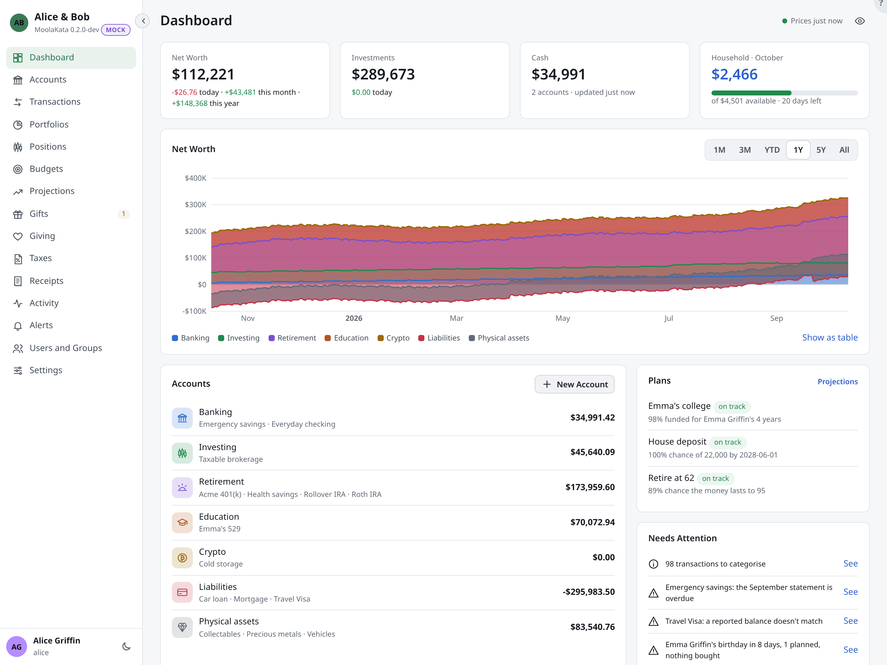

# MoolaKata

A self-hosted personal finance server for a household: bank, card, brokerage, retirement,
529 and bitcoin accounts in one place, kept current from files the household downloads
(OFX/QFX, CSV, PDF statements and photos of them, read on the server). It charts portfolios,
tracks options, projects retirement and education goals, keeps budgets, gifts, giving,
receipts and tax books, and prepares the numbers a tax return needs. Several people share one
server, and households on other MoolaKata servers can share with named people here, read
only, in a window of their own.

<picture>
  <source media="(prefers-color-scheme: dark)" srcset="docs/images/dashboard-dark.png">
  
</picture>

**Release:** 0.1.0, a pre-release for testers. Its images are `ghcr.io/mojokata/moolakata` and
`ghcr.io/mojokata/moolakata-connector`, for amd64 and arm64, each with a provenance attestation
`gh attestation verify` checks. The same images, with the same digests, are on Docker Hub as
`mojokata/moolakata` and `mojokata/moolakata-connector`. [`docs/DEPLOY.md`](docs/DEPLOY.md)
installs it on a Proxmox VE VM or on TrueNAS.

## Where to start

1. [`docs/requirements/`](docs/requirements/README.md): what MoolaKata is and does, in the
   present tense. Its README holds the decisions (R1), the terminology (R2) and the design
   principles (R3), and lists the sections S1–S18, the gaps not yet specified (G1, G2, …)
   and the open questions (Q1, Q2, …). S17 has the stack, the layout and the milestones
   (S17.9: the order to build in); S18 is the MoolaKata Connector, a second service.
2. [The clickable mockup](https://mojokata.github.io/MoolaKata/mockup/MoolaKata-mock.html), the design reference for
   every screen, as of the last merge to `main`; it sends nothing anywhere. The purple
   **MOCK** pill jumps to any screen, switches users, changes state and opens every dialog.
   **F1** toggles the help pane.
3. [The mockup generated from the app](https://mojokata.github.io/MoolaKata/mockup/MoolaKata-app.html) for the screens
   built so far, on recorded sample data, as of the last merge to `main`. Its **MOCK** pill
   jumps to screens and dialogs and switches users.

## Deploying

[`docs/DEPLOY.md`](docs/DEPLOY.md) builds the image and puts a server where people can test
it, step by step, on a fresh VM on Proxmox VE or on TrueNAS.
[`docs/operations.md`](docs/operations.md) is the runbook from then on: upgrades, backups,
restoring, keys and the connector. [`publish/truenas/`](publish/truenas/) holds the server and
the connector as apps for TrueNAS's community catalog, ready to propose there
([`docs/RELEASE.md`](docs/RELEASE.md) §12); until TrueNAS takes them, DEPLOY.md's **Install
via YAML** is how they go on a NAS.

## License

GPL-3.0, see [`LICENSE`](LICENSE).

Useful links: [dev](DEVELOP.md) · [coverage](https://mojokata.github.io/MoolaKata/) · [hardening](https://mojokata.github.io/MoolaKata/hardening.html) ·
[ui-kit](https://mojokata.github.io/MoolaKata/kit/) · mock [html](https://mojokata.github.io/MoolaKata/mockup/MoolaKata-mock.html) /
[app](https://mojokata.github.io/MoolaKata/mockup/MoolaKata-app.html)
