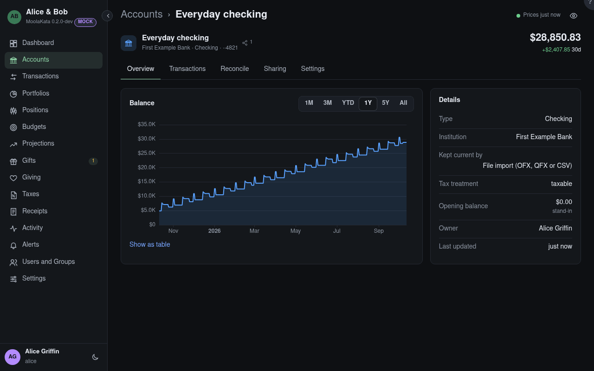

# Account: Overview

One account's balance over time and its details.

A loan's schedule is computed from its terms, set in its Settings.

## Range

How far back the chart goes. **Show as table** lists every point.

## Details

The account's type, institution, how it's kept current and its tax treatment.

## Opening balance

The balance before the first transaction. When none was typed, it's worked out from the earliest
balance the institution reported, and marked **stand-in**: it stands in for history that wasn't
imported.

{{account-type overview}}

## Options · capital at risk {#capital-at-risk}

Its options' market value, and what they put at risk: the most each strategy can lose at expiry, and
each option on its own counted the same way, as a strategy of its shape: a long option its premium,
a short put its strike less its premium, a short call the account's shares cover as a covered
call, and an uncovered one *unlimited*. Allocation charts keep market value.
