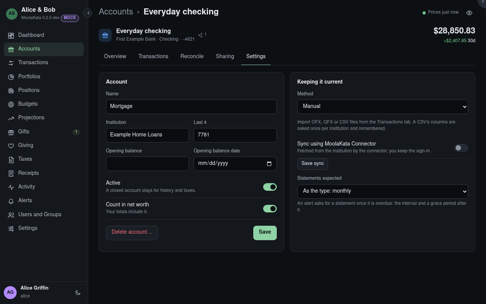

# Account: Settings

The account's name, how it's kept current, and its lot method.

## Name

What the account is called in your lists.

## Institution

The bank, broker or plan administrator: a label, not a connection.

## Last 4 {#mask}

The last four digits of the account number, to tell accounts apart.

## Lot method

Which lots a sale takes: **FIFO** the oldest first (the default), **LIFO** the newest, **HIFO** the
most expensive, **specific identification** the ones you pick, or **average cost**. The method in
force at a sale is recorded with it.

## Opening balance

A balance before the first transaction, with its date. Leave it empty to work it out from the
earliest balance the institution reported.

## Opening balance date {#opening-date}

The day the opening balance applies to.

## Active

A closed account stays, for history and taxes, but is marked closed.

## Count in net worth

Whether your totals include it.

## Delete account

Deletes it with its transactions, only by its owner. The click asks again first.

## Count in my totals

On an account shared with you: whether your net worth includes it. Off by default, so a spouse's
accounts count once.

{{account-type settings}}

## Method {#kept-by}

How the account is kept current: from files you import (OFX, QFX or CSV), or by hand.

## Sync using MoolaKata Connector {#sync-using-moolakata-connector}

The connector fetches this account from its institution with one of your connections and
imports what it fetches as an upload would. Only the account's owner turns it on; an account
shared with write can't be. **Save sync** keeps the choice. Each post shows in Activity as by
the connector and the connection.

## Connection

One of your own sign-ins kept by the connector (Profile › Connections), or **New connection…**
to start one here.

## Institution account

Which of the connection's accounts at the institution this account is, by name and last four
digits, from what the driver found on its first run; typed until then.

## Statements expected {#statements-expected}

How often the institution issues statements: monthly, quarterly, yearly or none. Left as the type,
it follows the account's type: monthly for banking, cards, brokerage, IRAs, HSAs and loans; quarterly
for 401(k)s, 403(b)s, 457(b)s and 529s; none for accounts kept by hand. A statement is overdue once
its period has passed and a grace after it (15 days monthly, 30 quarterly, 60 yearly): an alert
names the one missing, and clears when it arrives, read or kept. Once three statements or imports
have arrived, MoolaKata proposes the interval they arrive at when it differs; dismissed, it isn't
proposed again.

## Withdrawals allowed a month {#withdrawals-a-month}

A savings or money-market account's limit on transfers out, the bank's; empty for none. A budget's
**Where the money is** sums the moves back to checking into one transfer a month and warns before it
would go past the limit.
