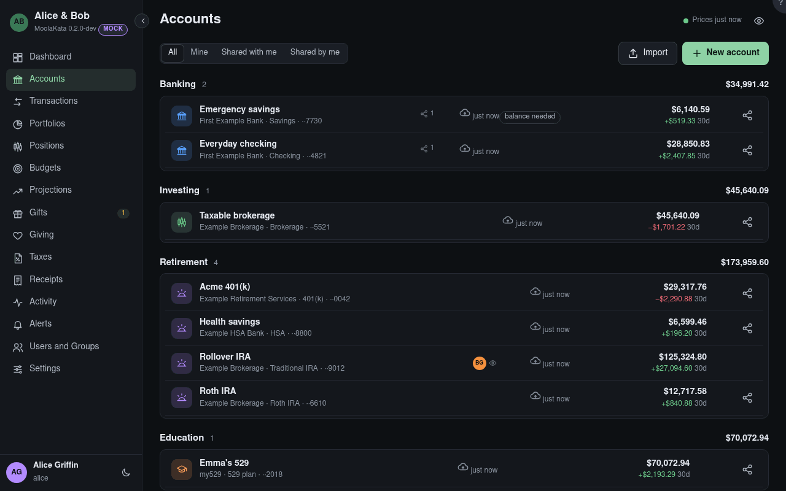

# Accounts

Every account you own or that someone has shared with you, grouped by kind.

Make an account with New account, then import its files.

## Show

**Mine**, **Shared with me** and **Shared by me**. A shared account shows its owner's avatar with an
eye (you can read it) or a pencil (you can change what it holds).

## Import

OFX, QFX or CSV from your bank or broker. Importing the same file again adds only what's new.

## New account

Pick the type first. It decides the fields, the tax treatment and the tabs the account has.

## Last updated

When the account last changed: its newest import or transaction.

## Mismatch

A balance the institution reported doesn't match MoolaKata's for that day. Open the account's
**Reconcile** tab to see what's suspect. **Balance needed** means its next statement or import is overdue.

## Share

Opens the Share dialog for that account. Only its owner shares it.

## Linked households {#linked-households}

Other households, on their own MoolaKata servers, that share something with you. Each opens in a
window of its own, never mixed with yours: its accounts never count in your totals. The household
avatar at the top of the sidebar lists them too.
