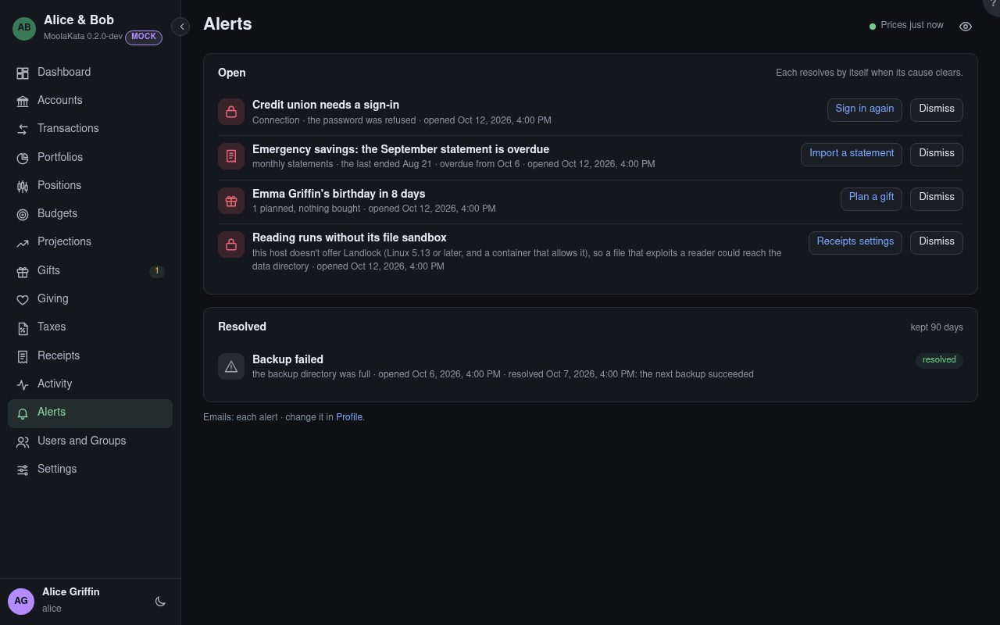

# Alerts

What needs you. Activity records what happened; an alert asks you to do something about it.

## Open

One alert per cause: a failing price source raises one alert, not one per try. It stays open while
the cause lasts and **resolves by itself** when the cause clears. The button beside it goes where to
fix it. **Dismiss** hides it for you alone; it stays open for anyone else it's for. An admin who owns
what failed, such as their own Connection, sees it once, as its owner.

Admins are alerted about a price source or email failing for longer than Settings › Alerts allows, a
failed backup, the yearly check of the master key's recovery phrase, and the receipt reader running
without its file sandbox on a host that doesn't offer Landlock. An account's owner is alerted when
its next statement or import is overdue, when its balance has disagreed with the institution's
for a week (a loan's with the servicer's balance typed on its Overview), when its statements keep arriving but a holding in it is still valued from an
older one, and when an import left out a loan's rows dated before the loan starts. That alert has
**Move the Start**, which opens the loan's terms, and **Leave Them Out**, which lets the rows go
and ends it at once; once the start is on or before them, **Add Them** goes to the loan's
Overview, where they are added.

## Resolved

Alerts whose cause cleared, kept for 90 days.

## Emails

Profile says how alerts reach you by email: each one as it opens, a daily summary, or none. They
never name an amount. Without email set up on the server, nothing is sent.
