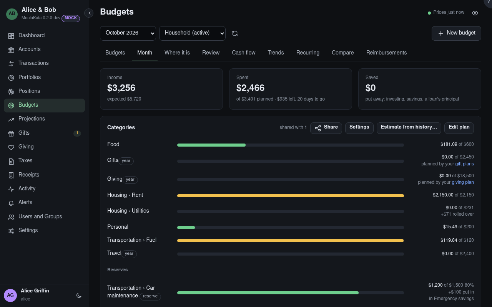

# Budgets

A budget plans spending per category over the accounts you choose, month by month. It is yours, or
shared: share it with a group at **Write** for a household budget everyone in it plans and follows.

## Month

The month shown. Past months keep the plan they had; a change to the plan applies from the month it
is made in.

## Budget

Which budget, when you have more than one or others share theirs with you.

## Categories

Each planned category's spending as a bar: green, then amber at 90% of the plan, red once over. A
parent category counts its children. A category with **rollover** carries what was left (or
overspent) into the next month. A **year** category compares the year so far with its yearly plan.

**Not in the plan** lists spending in categories without a plan. Transfers between the budget's
accounts never count.

## Saved

Money put away rather than spent: a transfer to an investment or savings account the budget doesn't
count, filed under a _Savings_ category, and a loan's principal. A plan line on a savings category
shows how much you meant to put away.

## Loan payments

A payment to a loan counts at the bank account it comes from, as the loan's **In budgets** setting
says: split into interest, escrow, PMI and fees, with the principal as saved, or whole.

## Left or entered the budget

Transfers between one of the budget's accounts and one it doesn't count. With a category they count
like any transaction: to a brokerage account as _Savings › Investing_, in from savings as income.
Without one they count nowhere until you sort them.

## Sort

Opens the transfer to give it a category.

## Edit plan

The amount per category from this month on. Anyone the budget is shared with at **Write** can change
the plan; only its owner chooses its accounts or shares it.

## Uncategorised

Transactions in the budget's accounts with no category yet. Sort them on the Transactions screen,
and they count.
