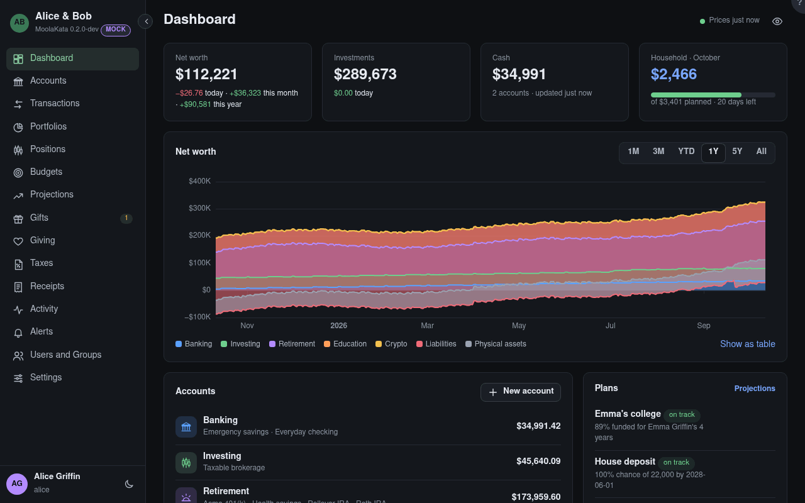

# Dashboard

Where you land after signing in: what you're worth, how it's moving, and what needs you.

## Net Worth

What your accounts are worth less what you owe on them: your own accounts that count in net worth,
and accounts shared with you that you set to **Count in my totals**. The change below it is since
yesterday, a month ago and a year ago.

## Investments

Brokerage and retirement accounts, valued at the latest daily close of what they hold.

## Cash

Checking, savings, money-market and CD accounts.

## Budget {#budget}

The budget you follow, this month: what was spent against what was planned. Open it for the rest.
In an envelope budget, spending charged to a card beyond what its envelope held counts as spent and
is named: *on cards, not backed*.
Without one, the count of what needs attention shows here instead.

## Allocation

What your accounts that count in net worth hold, by asset class: cash, bonds, US stocks,
international stocks, real estate, crypto and metals, each holding in the class a projection
grows it by; a home or land is real estate, a metal item metals, and any other item, such as a
car or a collectable, or an option is *other*. What you owe, on a loan or a card, takes no share.
**Details** opens *All my accounts*.
**Show as table** lists each class's value and share.

## Range

How far back the chart goes: a month, three months, this year, a year, five years, or everything.
**Show as table** lists every point, for a screen reader or for copying.

## Accounts

Your accounts by group, with each group's total. A click opens Accounts. With none yet, make one
with **New Account**, then import its files.

## New Account

Pick the type first: it decides the fields and the tax treatment.

## Plans {#plans}

Your active projections, and those shared with you that you chose to show: each with its status (on
track, ahead or behind its baseline), its answer, and a small chart of the actual balance against
the baseline.

## Needs Attention

Transactions to categorise, lots without a cost basis, accounts whose reported balance doesn't match
or whose next statement is overdue, an occasion coming up with nothing bought yet, a return past its
due date, a year whose realized gains changed after its federal return was filed, giving behind the
even pace to its target, a holding still valued from an old statement, items valued over a year ago,
a connection that needs a sign-in or is failing, and stale prices. Admins also see a price source
failing for longer than Settings › Alerts allows. Each line links to where it's fixed.

## Upcoming

Up to five recurring transactions due in the next 30 days, soonest first: each with its next
date, how often it comes, and its usual amount. They're found in your cash and card accounts' history, as a
budget's Recurring tab finds them; one that has stopped coming is left out.

> Prices are daily closes, never live. The dot by **Prices** at the top turns amber when a held
> instrument's price is stale.
