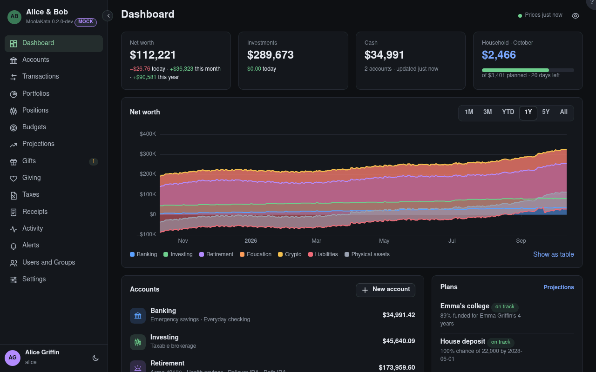

# Dashboard

Where you land after signing in: what you're worth, how it's moving, and what needs you.

## Net worth

What your accounts are worth less what you owe on them: your own accounts that count in net worth,
and accounts shared with you that you set to **Count in my totals**. The change below it is since
yesterday, a month ago and a year ago.

## Investments

Brokerage and retirement accounts, valued at the latest daily close of what they hold.

## Cash

Checking, savings, money-market and CD accounts.

## Budget {#budget}

The budget you follow, this month: what was spent against what was planned. Open it for the rest.
Without one, the count of what needs attention shows here instead.

## Range

How far back the chart goes: a month, three months, this year, a year, five years, or everything.
**Show as table** lists every point, for a screen reader or for copying.

## Accounts

Your accounts by group, with each group's total. A click opens Accounts.

## New account

Pick the type first: it decides the fields and the tax treatment.

## Plans {#plans}

Your active projections, and those shared with you that you chose to show: each with its status (on
track, ahead or behind its baseline), its answer, and a small chart of the actual balance against
the baseline.

## Needs attention

Transactions to categorise, lots without a cost basis, accounts whose reported balance doesn't match
or whose next statement is overdue, a return past its due date, a year whose realized gains changed
after its federal return was filed, and stale prices. Each line links to where it's fixed.

> Prices are daily closes, never live. The dot by **Prices** at the top turns amber when a held
> instrument's price is stale.
