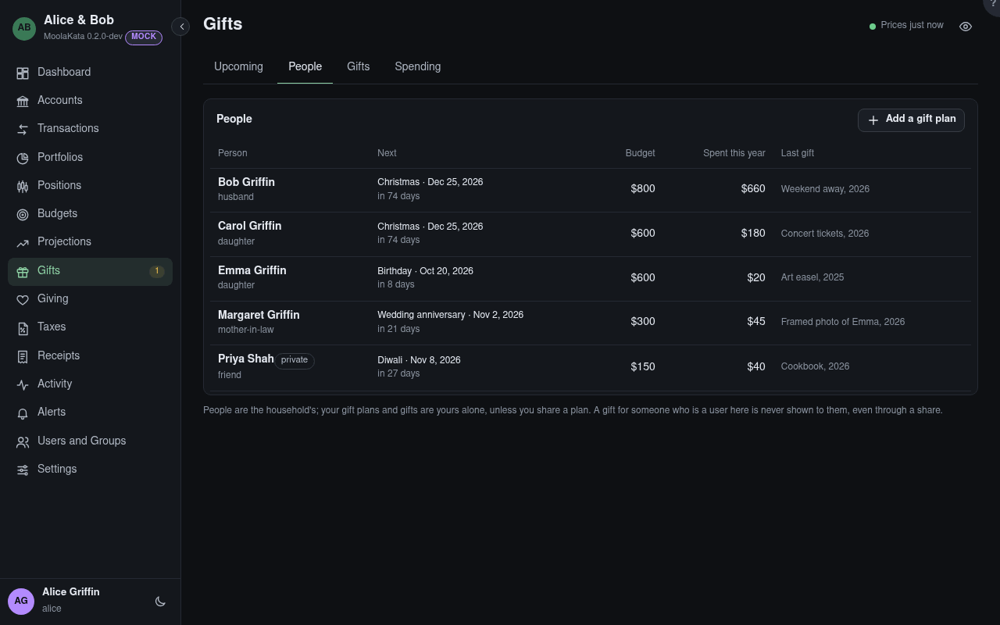

# Gifts: People

Your gift plans for the people you give gifts to: their dates, your budget, what you've spent on
them this year and the last gift you gave.

Add the people you give gifts to, with their dates.

## People

The pencil at the end of a person's row changes their dates, budget and notes, shows what you gave
before, and shares the plan; a plan shared with you to read has an eye instead. People are the
household's, each shown with how they're related to you; your gift plans are yours alone, unless you
share one: a couple plans their children's gifts together that way. A gift for someone who is a user
here is never shown to them, even through a share. **Add a gift plan** starts one for someone
already here, or adds them.
