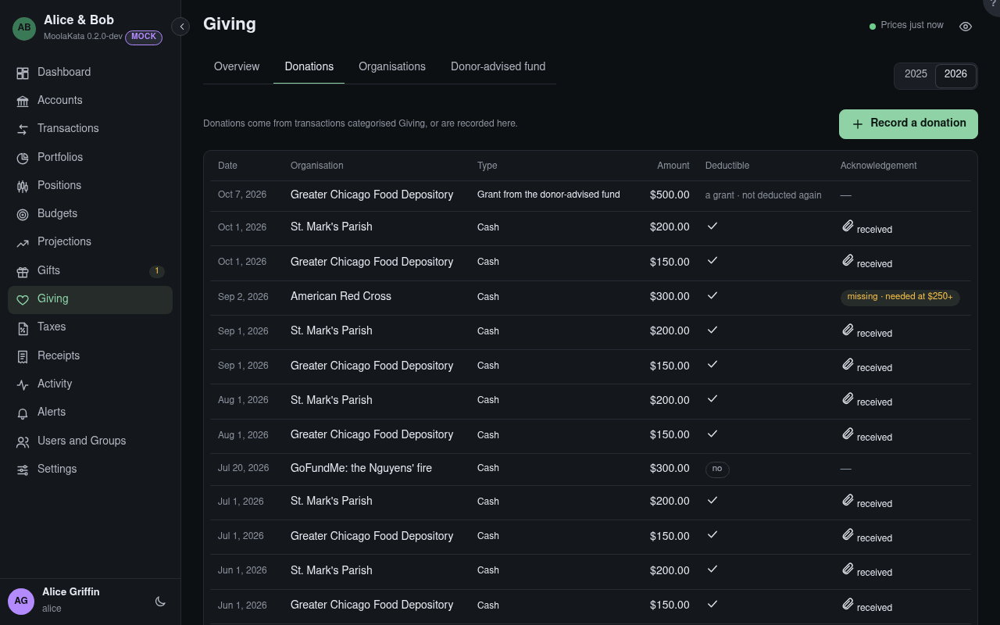

# Giving: Donations

Every donation in the year: those recorded here, and spending in a category tagged charitable.

## Year

The year shown.

## Plan

Shown when someone shares their giving plan for the year with you: **Mine** shows your own giving,
their name theirs. What you add goes into the plan shown; into one shared with you to read, you
can't add.

## Record a Donation

Cash, goods, appreciated shares, a qualified charitable distribution from an IRA, a contribution
into a donor-advised fund, or a grant from one.

## Donations

Each with its type, amount, whether it's deductible, and its acknowledgement. A written
acknowledgement is needed for any single gift of $250 or more; one that's missing is marked
*missing*. A grant from a donor-advised fund is marked *grant*, not deducted again: its money was
deducted when it went into the fund. A transaction in a category tagged charitable (Giving and
its sub-categories, or any other given the tag) counts as cash until it's recorded with its
organisation; a split one counts its charitable parts, each on its own.
