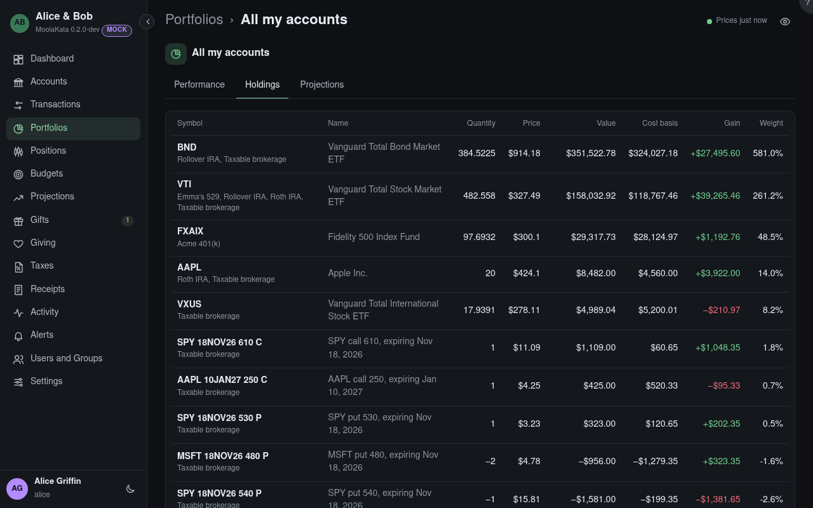

# Portfolio: Holdings

What the portfolio's accounts hold, added up by instrument, with each loan and item on a row of
its own. The total is the portfolio's value.

## Allocation

What the portfolio holds, by asset class: cash, bonds, US stocks, international stocks, real
estate, crypto and metals, each holding in the class a projection grows it by; a home or land is
real estate, a metal item metals, and any other item, such as a car or a collectable, or an
option is *other*. What you owe, on a loan or a card, takes no share.
**Show as table** lists each class's value and share.

## Weight

Each holding's share of what the portfolio holds: cash, holdings and items. What a loan owes takes
no weight.

## Loans and items

A loan's row is what is still owed on it, which counts against the total; an item's, what it is
worth, from its valuations, spot or depreciation.

## Cost Basis

What you paid for what you hold, fees included.

## Stale

A price older than it should be: two trading days for a stock's close or last trade, or 90 days for
a typed price.

## Options · capital at risk {#capital-at-risk}

The options' market value in these accounts, and what they put at risk: the most each strategy can lose at expiry, and
each option on its own counted the same way, as a strategy of its shape: a long option its premium,
a short put its strike less its premium, a short call the account's shares cover as a covered
call, and an uncovered one *unlimited*.
