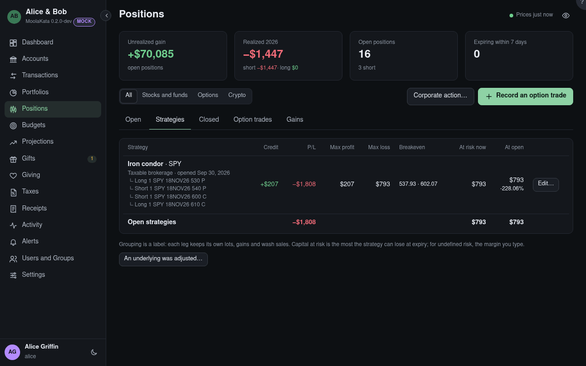

# Positions: Strategies

Legs held together, such as a covered call, a vertical spread or an iron condor, shown as one.
Grouping is a label: each leg keeps its own lots, gains and wash sales.

Legs opened together are offered here as a strategy; or select legs on the Open tab and Group them.

## Proposed

Legs on one underlying opened in one account on the same day are offered as a strategy, and so is a
short call against the shares it delivers, held: 100 a contract, or what an adjusted contract
delivers, the shares a merger brought included. **Group them**, or **Not a strategy**, which isn't
asked again. A leg closed and another opened on the same underlying the same day is offered as a
roll: kept in the strategy, it keeps its history, closed legs and their P/L included.

## Strategy

Its shape, worked out from its open legs: long and short calls and puts, a cash-secured put, a
covered call, a protective put, a collar, bull and bear spreads, straddles and strangles, an iron
condor or iron butterfly, a butterfly, a calendar or a diagonal; anything else is _Custom_.

## Max profit and max loss

At expiry, _unlimited_ where it is. Shares count at their value on the day the strategy opened. A
contract adjusted to deliver another company's shares counts them at that company's price; with no
price for them, the figures read _not priced_. A calendar or diagonal shows its P/L only, as its
outcome rests on volatility.

After a symbol change or a merger, the strategy's shares are the new ones, at the action's ratio.

## At risk now {#at-risk-now}

Capital at risk at today's prices: the most the strategy can lose at expiry. For a strategy whose
loss has no limit, the broker's margin requirement you type, or _unlimited_, and then the total is
unlimited too. One _not priced_ takes the margin you type too, or reads _not priced_, and the total
reads unlimited, as no limit to it is known.

## At open {#at-open}

Capital at risk for the legs the strategy opened with, at the prices of that day, whatever was
rolled or closed since; its return is worked on this.

## Group legs

Select legs on the **Open** tab and **Group** them, in one account and on one underlying.
