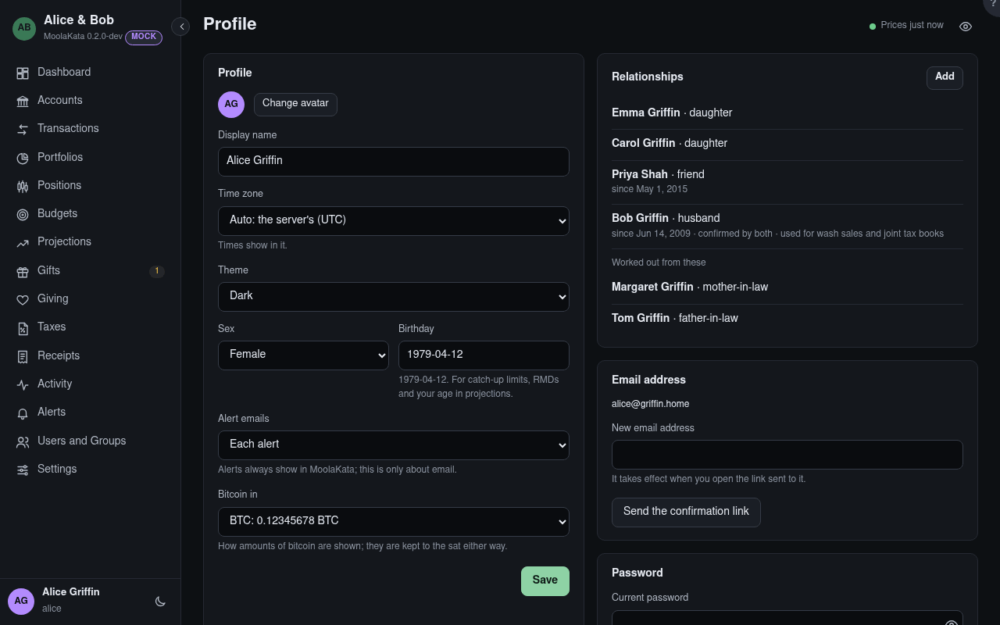

# Profile

Your name, email, password, two-step sign-in and how MoolaKata shows things to you.

## Change avatar {#avatar}

An image, made small in your browser before it's saved.

## Display name

Your name as others see it.

## Time zone

Times show in it. **Auto** follows the server's.

## Theme

Dark, light or your system's. The button at the foot of the sidebar switches it too.

## Sex

Chooses the words for the family tree: wife or husband, mother-in-law or father-in-law.

## Birthday

For retirement contribution catch-up limits, required minimum distributions and your age in
projections.

## Alert emails

Whether alerts reach you by email: each one, a daily summary, or none.

## Bitcoin in {#bitcoin-unit}

How amounts of bitcoin are shown to you: **BTC** (0.12345678 BTC) or **sats** (12,345,678 sats).
They are kept to the sat either way.

## Relationships

Your spouse, children, friends and colleagues, each from a date and, once over, to a date. Parents,
grandparents, cousins and in-laws are worked out from them. Your spouse on the day of a sale counts
for **wash sales** (a loss sale with a purchase of the same thing within 30 days either side), and
your spouse on the last day of a year for a joint tax book, once you have both confirmed the
marriage: one your spouse entered shows **Confirm** here. Click one to change its dates, such as a
divorce's, or to remove it.

## New email address

It takes effect when you open the link sent to it.

## Your password {#reauth-password}

Asked again when you last gave it more than 10 minutes ago.

## Current password

Your password now.

## New password

At least the minimum length, and not a common password. Changing it signs out your other sessions.

## Two-step sign-in {#two-step}

After your password, a code from an authenticator app on your phone, so a stolen password alone
can't sign in. **Turn on** shows a QR code to scan; **New recovery codes** replaces the ten codes
that sign in when the phone is lost. Turning it on or off emails you.

## Your password {#two-step-password}

Asked again when you last gave it more than 10 minutes ago.

## Connections {#connections}

Your sign-ins at institutions, kept by the MoolaKata Connector and never by MoolaKata: each with
its driver (Schwab, OFX Direct Connect or a folder of downloads), the institution accounts the
driver found, the accounts here it keeps current, and its state from the connector's last
report. **New connection** starts one; **Sign in again** or **Change credentials** gives the
connector new ones, sealed in this browser to its key so MoolaKata can't read them; **Remove**
(the click asks again) turns its accounts' sync off, and the connector deletes its credentials.
A connection that needs a sign-in, as Schwab's does each week, alerts you.

## Access tokens {#access-tokens}

Let an AI assistant, or another tool that speaks the Model Context Protocol, read your finances at
the MCP endpoint shown. A token reads, never changes anything, and sees only what you can see, or
the accounts and portfolios you chose for it; never secrets, Settings or linked households. Each
shows what it can read, when it expires and when it was last used. **Revoke** stops it at once (the
click asks again first). Its calls are recorded in Activity under its name.

## Ignored statement lines {#ignored-statement-lines}

The starts of statement lines you asked to ignore, with **Remember…** when checking a statement,
by institution. **Remove** reads them again from its next statement.

## Assumptions

Used by all your projections, so they agree: each asset class's expected yearly return and
volatility, and inflation. A projection can override a figure. Long-run figures, not forecasts.

## Expected return {#expected-return}

The average yearly return you expect of the class, in percent.

## Volatility

How much a year's return swings around it (its standard deviation), in percent. Monte Carlo draws
each year's return from these.

## General inflation (%) {#general-inflation}

For today's dollars and withdrawals that rise with prices. 2.5% by default.

## Education inflation (%) {#education-inflation}

College costs rise faster: 5% by default.

## Bitcoin model

For the bitcoin in your projections: your crypto assumption, or a published model. **Compare
models** shows them side by side with their sources and records. Other coins use the crypto row.
