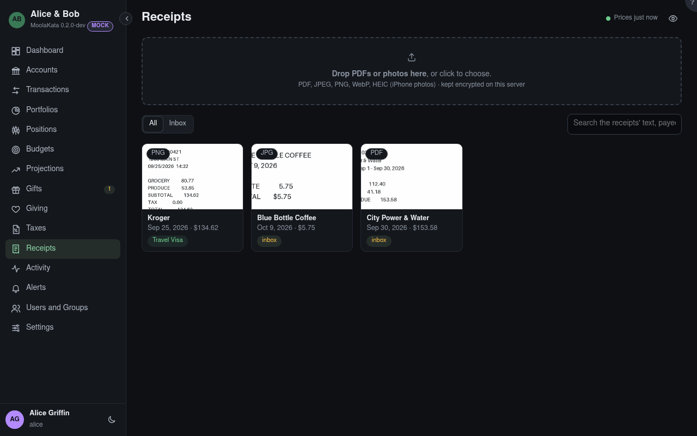

# Receipts

PDFs and photos of receipts, invoices and statements, kept encrypted on this server and attached to
the transactions they belong to.

The inbox holds receipts not yet attached to anything; a receipt dropped above lands there.

## Drop PDFs or photos here {#receipt-files}

PDF, JPEG, PNG, WebP and HEIC (iPhone photos), many at once, each up to the size in Settings ›
Receipts. The type is checked from the file itself. A file you already uploaded isn't stored twice:
you get the receipt you have.

## Show

**All**: every receipt you can see, yours and those kept with things shared with you; or the
**Inbox**: your receipts attached to nothing yet.

## Search

Matches the text read from each receipt (`blue bottle`, `142.18`), and its payee, amount, file name,
notes and tags.

## Being read

Each upload is read on this server in the background: **Reading…** until it's done, then its fields
are filled in. **unreadable** says why; the receipt still works with its fields typed by hand.

## Sharing

A receipt is seen through what it is kept with: a transaction's by whoever can read the
transaction; a gift's through the gift plans that show the gift; a donation's by its owner and those
who see the giving plan it counts in; one kept with a physical-asset item, a loan, a 529 expense or
an account (a statement) by whoever can read that account; and a tax document's file by whoever can
read the tax book. A statement imported into an account is the account's owner's, whoever
imported it, and goes with a share that ends. One attached to nothing is yours alone. Only you can delete your receipt, and
only once nothing links to it.
