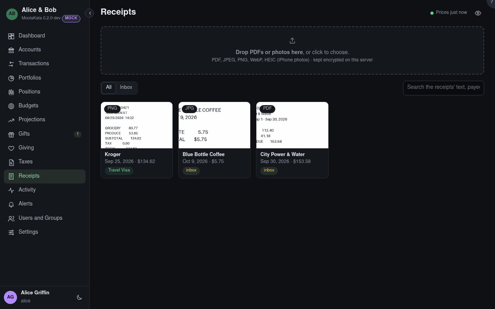

# Receipts

PDFs and photos of receipts, invoices and statements, kept encrypted on this server and attached to
the transactions they belong to.

The inbox holds receipts not yet attached to anything; a receipt dropped above lands there.

## Drop PDFs or photos here {#receipt-files}

PDF, JPEG, PNG, WebP and HEIC (iPhone photos), many at once, each up to the size in Settings ›
Receipts. The type is checked from the file itself. A file you already uploaded isn't stored twice:
you get the receipt you have.

## Show

**All** your receipts, and those attached to transactions in accounts shared with you; or the
**Inbox**: your receipts attached to nothing yet.

## Search

Matches the text read from each receipt (`blue bottle`, `142.18`), and its payee, amount, file name,
notes and tags.

## Being read

Each upload is read on this server in the background: **Reading…** until it's done, then its fields
are filled in. **Couldn't read it** says why; the receipt still works with its fields typed by hand.

## Sharing

A receipt is seen by whoever can read a transaction it is attached to. One attached to nothing is
yours alone. Only you can delete your receipt, and only once nothing links to it.
