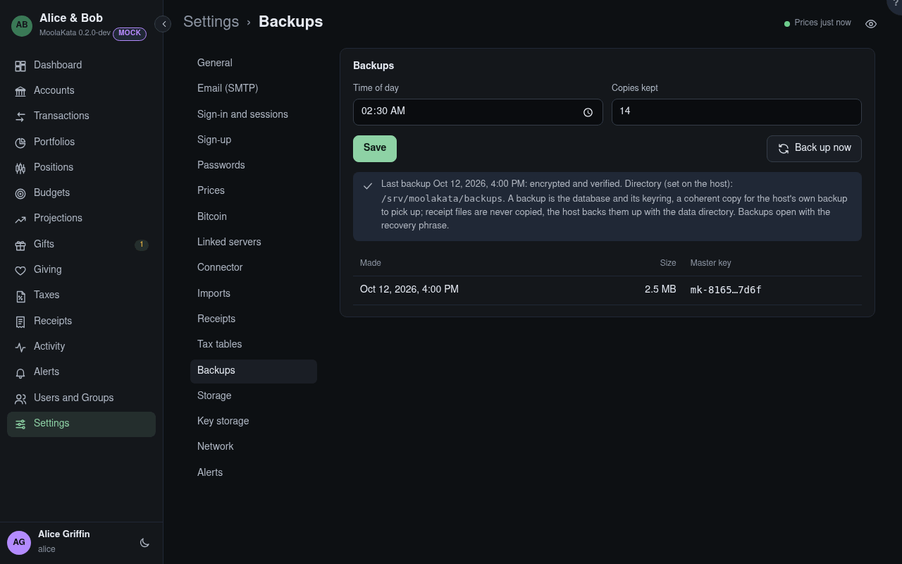

# Settings: Backups

Daily copies of the database with its keyring, made, checked and pruned by the server. Never
the receipt files: the host backs up the data directory, files and all, and this copy exists so
that the live database the host picks up has a coherent, verified twin beside it. The backup
directory belongs inside what the host backs up.

A backup is the database and its keyring, a coherent copy for the host's own backup to pick up;
receipt files are never copied, the host backs them up with the data directory. Backups open with
the recovery phrase.

## Time of day

When the daily backup runs.

## Copies Kept

How many days of backups stay: every backup of each of the most recent days that have one, 14
by default, never fewer than 3. Older days' are deleted. **Change** sets it; fewer days than
the backups there are asks for the recovery phrase too.

## Directory

Where backups are written: set on the host, outside the data directory.

## Backup Now

Makes a backup now.

## Restoring

Backups are encrypted as the data is, and open with the recovery phrase of their day; each
carries its own keyring, and a rotation re-encrypts it when told to. A restore puts the database
and keyring back and leaves the receipt files where they are, re-wrapped to the backup's key when
a re-encryption came between.
