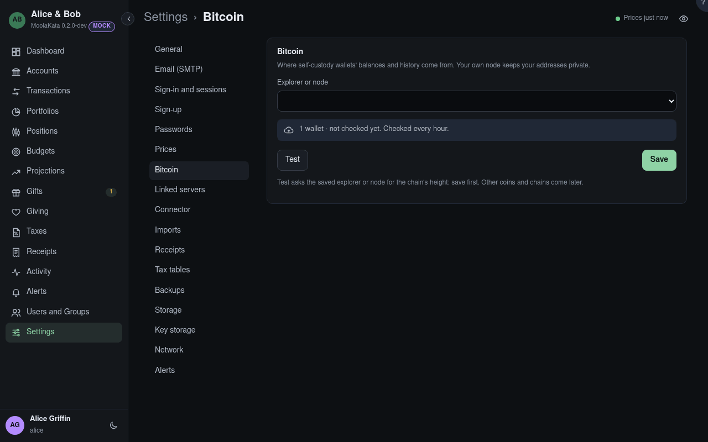

# Bitcoin

Where self-custody wallets' balances and history come from: a public explorer, or the
household's own node. Admins only.

Wallets are checked every hour; none is read until this section is saved. Other coins and chains
come later.

## Explorer or node

**Public: mempool.space** or **Blockstream**: nothing to set up, but the explorer sees which
addresses are asked about. **Own node**, which keeps them private: a **mempool or Esplora**
instance, an **Electrum server** (Fulcrum or electrs), or **Bitcoin Core**, where MoolaKata keeps a
watch-only descriptor wallet for each wallet account. Only public keys and addresses are ever sent.

## Esplora address {#esplora-url}

Your own instance's API: `http://umbrel.local:3006/api`, for example. It is needed: left
blank, Save asks for it rather than read the public mempool.space in its place.

## Node address {#node-host}

The node's host name or address on your network. Naming it here lets MoolaKata reach it there,
past the guard that otherwise keeps it off local addresses. Changing it clears the node's stored
password, so it is never sent to the new host.

## Node port {#node-port}

50002 for an Electrum server with TLS (50001 without); 8332 for Bitcoin Core.

## TLS

*For an Electrum server:* usually on, on port 50002; off on port 50001. *For Bitcoin Core:* on when
Core is behind a TLS proxy.

An Electrum server's TLS, usually on. Its certificate is usually one it made itself, so it is
trusted on first use: **Test** shows its SHA-256 fingerprint, and once you confirm it, any other
certificate is refused, and admins alerted, until you confirm the new one.

## Certificate

The Electrum server's certificate trusted, by its SHA-256 fingerprint. Until one is trusted,
**Test** shows the server's, to confirm. Confirm a new one only if you know why it changed, such as
the node being set up again.

## RPC user {#rpc-user}

Bitcoin Core's `rpcuser`, or the user of an `rpcauth` line.

## Node password {#node-password}

Its password. Stored encrypted, never shown again: the field says when it was set and by whom, and
a new one typed replaces it.

## Last checked {#checked}

How many wallets there are and when they were last read. Wallets are read every hour, and each
wallet's **Check Now** reads it at once. A failure lasting longer than Settings › Alerts allows
alerts admins and each wallet's owner.

## Test

Asks the saved explorer or node for the chain's height, and says what failed. Save first.

Setting or replacing the node's password asks for your password again when it was given over 10
minutes ago.
