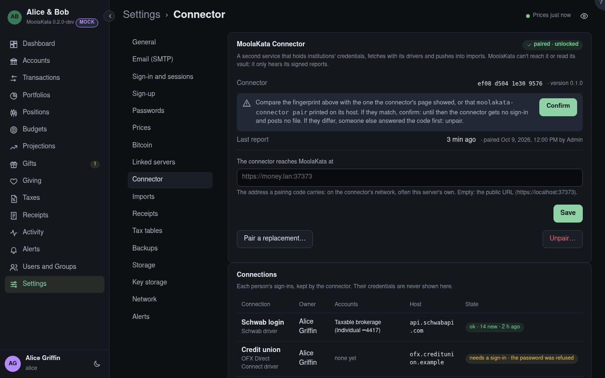

# Connector

The MoolaKata Connector is a second service that keeps people's sign-ins at their institutions,
fetches with its drivers, and pushes what it fetches into imports. MoolaKata can't reach it or
read its vault: it only hears its signed reports, every five minutes. Admins only.

The card shows whether a connector is paired, its key's fingerprint, the version it runs, when
it last reported and whether it is **locked**. It starts locked after every restart of its own;
an admin unlocks it with its 12 words on its page, or on its host. A connector not heard from
for 15 minutes, or locked, raises an alert for admins.

## Its page {#its-page}

The connector serves a small page of its own, on its own port, linked here once it has
reported. There its vault is made and its words are given: **Unlock** after a restart,
**Lock**, **Pair** with the code from here, **Unpair** and **Reset**. Anyone on the network can
see its status there, which names no institution, sign-in or account; every action asks for
the words. MoolaKata only links to it and never sees the words.

## Pair {#pair}

Shows a one-time pairing code, valid 24 hours, to paste into **Pair** on the connector's page
with its words, or in the command to run on its host. It holds this server's address and key
fingerprint; the connector then introduces itself, and
both sides show its fingerprint for you to compare. One connector is paired at a time: pairing
another replaces it, as Unpair does. Needs your password again when it was given over 10
minutes ago.

## Confirm {#confirm}

After pairing, compare the fingerprint shown here with the one the connector's page showed (or
`moolakata-connector pair` printed on its host). If they match, **Confirm**, after your password: only then does
the connector get sealed sign-ins and post files. If they differ, someone else answered the
pairing code first: **Unpair**. Until confirmed, people see in the connection dialog that no
sign-in can be sealed yet.

## Accept {#accept}

Shown when the connector reported from an address other than the one known, and kept until an
admin answers it, whichever address reports next. If the connector moved (a laptop on another
network, a new host), **Accept** the new address, after your password, and the alert closes. If
it didn't, its host or volume may have been copied: **Unpair** at once, since whoever has the
copy can report as the connector.

## Unpair {#unpair}

Refuses the connector's key from then on, stops every Connection, and turns every account's
sync off. The connector deletes the credentials it held for this server. Needs your password
again when it was given over 10 minutes ago. Unpair at once when the connector's host or its
volume is lost or stolen. The copy holds only its status key, which can say no more than that
the connector is locked; the vault, with the sign-ins and the keys that act as the connector
and open sealed credentials, stays closed without the words.

## Connections {#connections}

Every person's sign-ins, kept by the connector: who owns each, its driver (Folder, OFX Direct
Connect or Schwab), the accounts it keeps current, and its state from the last report: ok with
what the last run added, waiting for credentials, needs a sign-in, or failing with the
connector's words. Credentials are never shown here, or anywhere: they exist only in the
connector's vault. People start and change their own under Profile › Connections.
