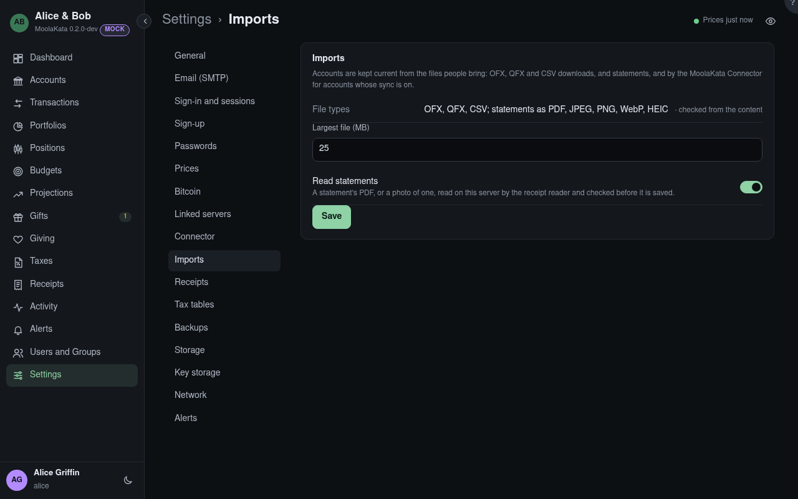

# Settings: Imports

Accounts are kept current from the files people bring (OFX, QFX and CSV downloads, and
statements) and by the MoolaKata Connector for accounts whose sync is on.

## File types

OFX, QFX and CSV, and statements as PDF, JPEG, PNG, WebP or HEIC, checked from what's inside the
file, never its name.

## Largest file {#largest-file}

The biggest file that can be imported: 1 to 200 MB. The chevrons, and ↑ ↓, step by 5 MB, to a
multiple of 5; Page Up and Page Down by 50.

## Read statements

Whether a statement's PDF or photo can be imported. It is read on this server by the receipt reader,
in its own process, and checked by the person before anything is saved. Off, only OFX, QFX and CSV
files import.
