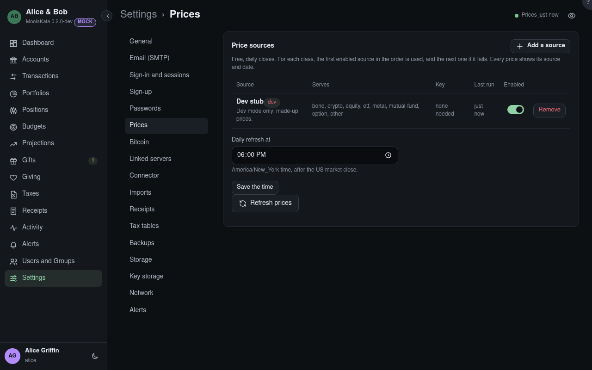

# Settings: Prices

Where daily closes come from. Prices are free and daily, never live.

## Price Sources

The sources added, each with the classes it serves. For each class the first enabled source in the
order is used, and the next one when it fails. Every price shows its source and date.

Until a source is added, prices are off: holdings are valued from the brokers' files and the last
trade.

## Symbols No Source Knows {#unknown-symbols}

Held symbols that every enabled source serving their kind was asked for at the last daily refresh,
and none knew: a typing mistake, or a fund the sources don't list. Each leaves the list once a
source gives it a price, or once nobody holds it. Only symbols in accounts you can see are named;
the rest are counted.

## Add a Source

Every source MoolaKata ships. One that needs a key can't be enabled until its key is set.

## Enabled {#enabled}

Whether the source is used.

## Key

A source's key is stored encrypted and never shown again: only that it is set, when and by whom.

## Last Run

When the source was last used, and its last error.

## Daily refresh at

When the daily refresh runs, in the time zone the field names, after the US market close. 6:00 PM
Eastern by default.

## Refresh Prices

Runs the daily refresh now.

{{part prices-tiingo}} {{part prices-coinbase}} {{part prices-manual}}
