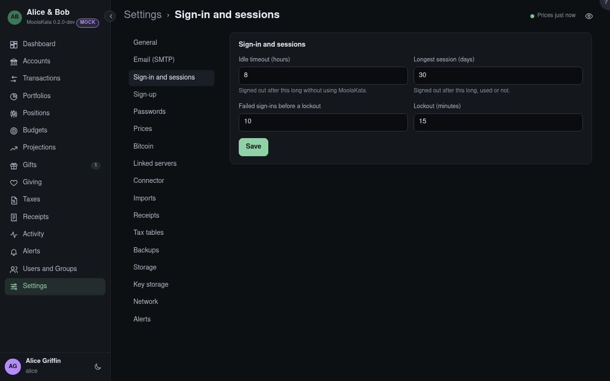

# Settings: Sign-In and Sessions

How long a sign-in lasts and when repeated failures lock the address they come from.

## Idle timeout {#idle-timeout}

Hours without using MoolaKata before a session ends: 1 to 168 (a week), 8 by default. The
chevrons, and ↑ ↓, step by 4 hours, to a multiple of 4; Page Up and Page Down by 40.

## Longest session {#longest-session}

Days a session lasts, used or not: 1 to 365, 30 by default.

## Failed sign-ins before a lockout

Wrong passwords or codes in 15 minutes, from one address, that lock that address. 10 by
default. A username that keeps failing, from anywhere, is only slowed, never locked, so nobody
can lock an admin out by typing wrong passwords from afar. While the server is locked, wrong
recovery phrases at the unlock count against the defaults, 10 for 15 minutes, since these
settings can't be read until it is unlocked.

## Lockout {#lockout}

Minutes a locked address waits: 1 to 1,440 (a day), 15 by default.
