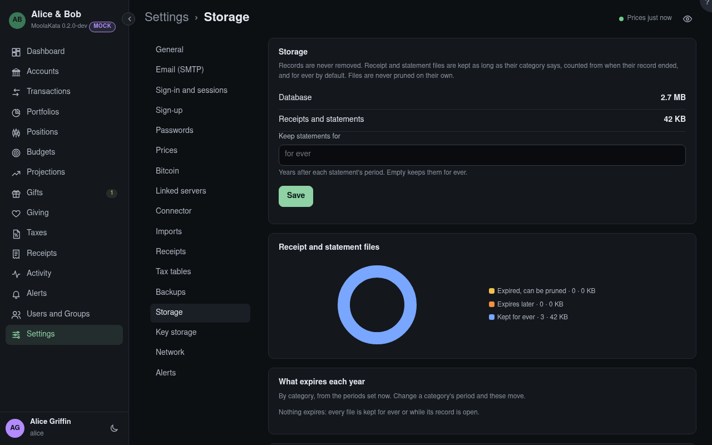

# Settings: Storage

How much the database and the files take, and how long receipt and statement files are kept.
Records are never removed: only files whose retention has run out, and only when an admin prunes
them here. Receipt and statement files are kept as long as their category says, counted from when
their record ended, and for ever by default. Sizes and counts only, never what the files hold.

## Prune

Opens the files that have expired, by category, to prune. No backup is made first: a backup holds
no files, and a pruned file survives only in the host's own backups of the data directory.

## Files no record names {#files-no-record-names}

Files in the receipts directory that no receipt, deleted or not, refers to: left behind when an
older database was restored under files written after it. **Remove** deletes them, after your
password.

## Keep statements for {#keep-statements-years}

Years after each statement's period. Empty keeps them for ever, the default.

## Receipt and Statement Files {#files}

The files expired and prunable, those that expire later or are kept while their record is open,
and those kept for ever.

## What Expires Each Year {#what-expires-each-year}

By category, from the periods set now: change a category's period and these move. *Nothing
expires* when every file is kept for ever or while its record is open.

## Keep Receipts For {#keep-receipts-for}

Each category's period: years after the record a receipt is attached to ended. A subcategory
without its own takes its parent's; empty keeps them for ever, the default.
