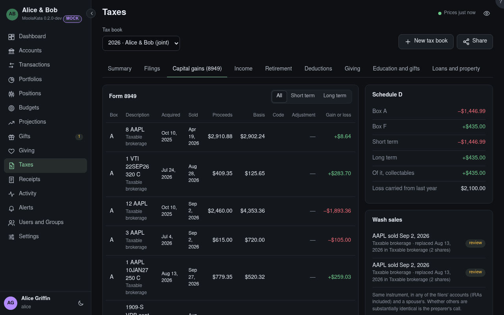

# Taxes: Capital Gains (8949)

Every sale in the book's taxable accounts in the year, and each physical asset sold, as Form 8949
rows, with the Schedule D totals.

A sale TXF can't carry is left out of it: enter those from the CSV.

## Tax book

The book shown, for one tax year. Its panels count the book's accounts only, and say which were left
out.

## Term

All sales, or only the short- or long-term ones.

## Form 8949

Each sale: its box (A–C short term, D–F long term, by whether the broker reports the basis to the
IRS, and C or F with no 1099-B, as for items; from 2025, digital assets such as crypto have boxes of
their own, G–I short term and J–L long term, a self-custody wallet's sales in I or L, and years
before put them in A–F), what was sold, when it was bought and sold, the proceeds, the basis, the
adjustment code (W a wash sale, L a loss on personal-use property, C a collectable) and amount, and
the gain or loss.

## Schedule D

The totals by box, short and long term, the collectables among them (taxed at their own rate), and
last year's capital-loss carryover.

## Wash Sales

A loss sale with the same instrument bought within 30 days either side, in any of the filers'
accounts (IRAs included) or a spouse's: the disallowed loss, and the replacement lot with its basis
raised by it. None is found when no loss sale was replaced within 30 days. Whether another
instrument is substantially identical is the preparer's call, so these are marked *review*, each
within 30 days either side, and nothing is disallowed: a stock's loss with an option on it bought or
written, or with its shares bought back through an option (a put assigned, a call exercised); an
option's loss with the same option, or another on the stock, bought or written to open, or with the
stock bought; a short sale's loss with another short sale of the stock; and a loss with shares of
the stock bought to close a short sale. The trade a sale is part of (the option that opened the
position sold, or whose assignment made the sale) is never its own match. A sale more than one of
these flags is one review, with a pill for each, and is listed in the Issues too.
