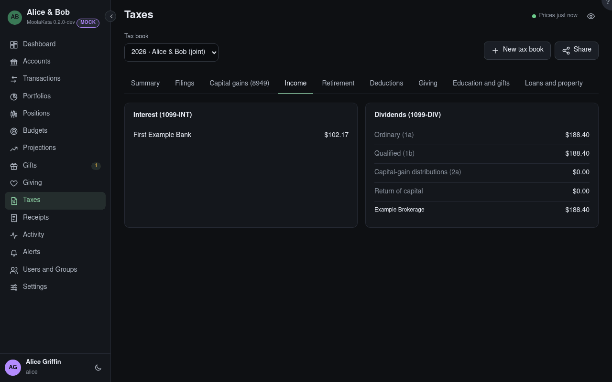

# Taxes: Income

Interest and dividends in the book's taxable accounts, as the 1099s report them.

## Tax book

The book shown, for one tax year. Its panels count the book's accounts only, and say which were left
out.

## Interest (1099-INT)

Interest by payer.

## Dividends (1099-DIV)

Ordinary dividends (qualified ones included), qualified dividends, capital-gain distributions and
returns of capital, with the totals by payer.

## Foreign Tax Paid (7) {#foreign-tax}

What funds paid abroad on their dividends, by payer, as the 1099-DIV's box 7 reports it: the foreign
tax credit is worked out from it. A broker's file brings it on a line of its own beside the
dividend; it can be typed too, as *Foreign tax paid*.

## Crypto Income {#crypto-income}

Coins received as income (staking, rewards), at their value on the day they arrived, by account:
ordinary income, often on no form. That value is also each one's cost basis, so a later sale's gain
is counted from it.
