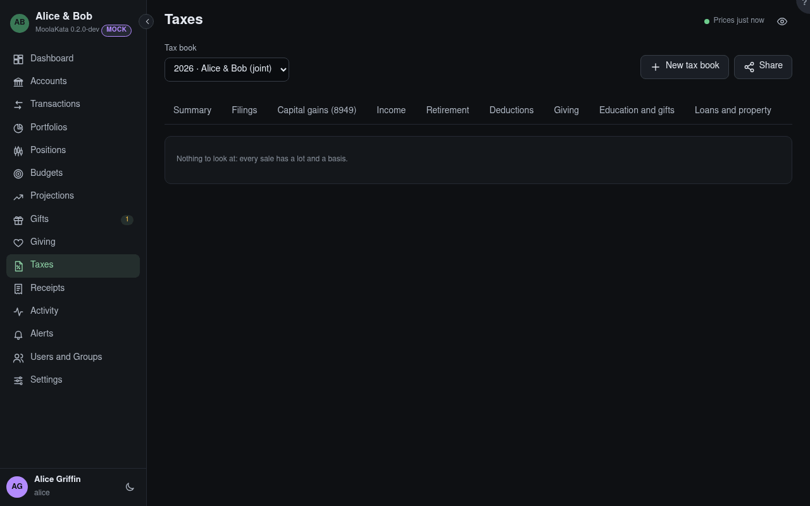

# Taxes: Issues

Missing or doubtful data to look at before the return is prepared.

## Tax book

The book shown, for one tax year. Its panels count the book's accounts only, and say which were left
out.

## Issues

Sales without a matching lot, lots and sales without a basis, shares received from another person's
account (which keep the giver's basis), and accounts left out of the book. With none of these,
there is nothing to look at.

A change made anyway to a year whose federal return is filed is listed first, with how far it
moved the realized gains and in which accounts: an edit, a trade in another account or a spouse's
that makes a wash sale, an account deleted or left out, a statement imported. A file read in the
background, or a Connection's, can't ask first: it is kept and listed the same way. **Add an
amended return** goes to Filings: adding one that amends the federal return settles the changes,
and opens the year until it is filed. **No Amendment Needed** settles them instead.

The gains are also kept as they were when the federal return was filed. A difference that no change
made here explains (a rule corrected since, a backup restored) is listed on its own, with the
accounts it is in: check the return against it.
