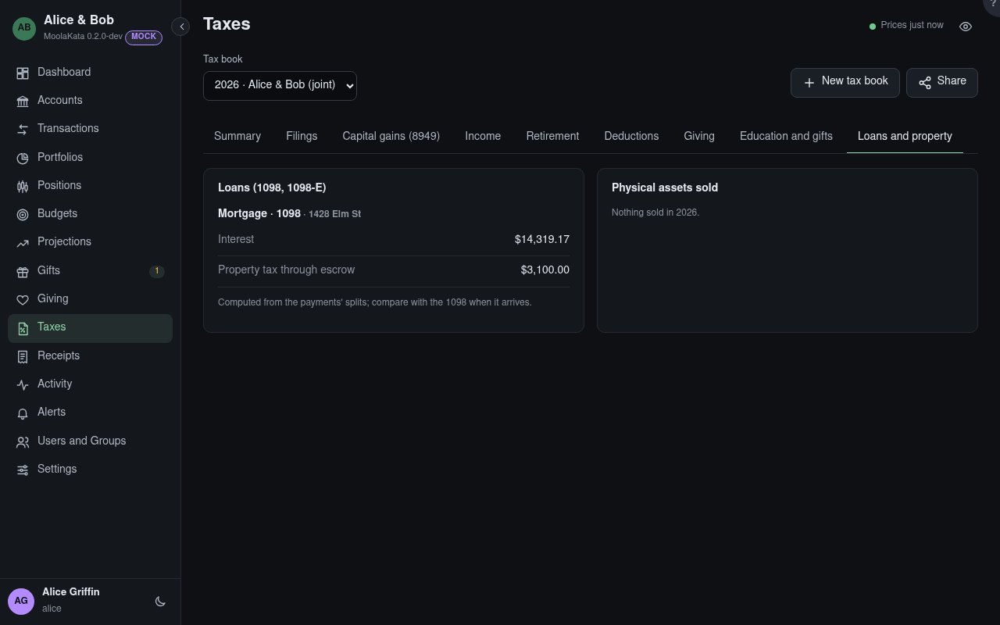

# Taxes: Loans and Property

Mortgage and student-loan interest, and physical assets sold.

## Tax book

The book shown, for one tax year. Its panels count the book's accounts only, and say which were left
out.

## Loans (1098, 1098-E)

Interest, PMI and property tax through escrow per loan, from the payments' splits, and a mortgage's
points from its terms: a purchase's in the year paid, a refinance's share of this year. Compare with
the Form 1098 when it arrives; a refinance's points aren't on it.

## Physical Assets Sold

Each item sold in the year with its gain; collectables are marked, and a loss on personal-use
property isn't deductible. An inherited item's date acquired reads *INHERITED*, as Form 8949 asks,
with the day it came below it. A sold home someone lived in as their main home shows its gain,
the years owned and, from the residence periods typed on the home, each person's years lived in
within the five before the sale; the exclusion is the preparer's to apply.
