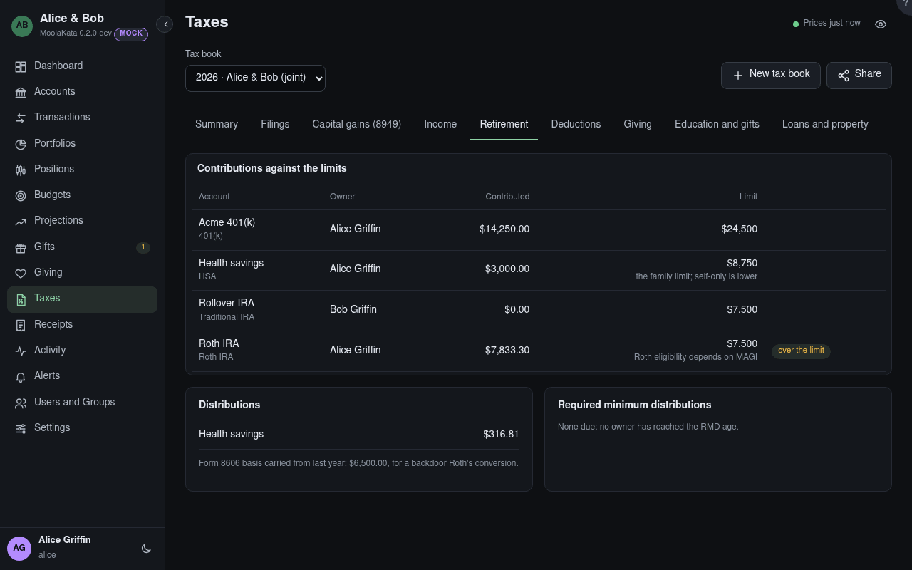

# Taxes: Retirement

Contributions against the year's limits, distributions, and the required minimum distributions due.

## Tax book

The book shown, for one tax year. Its panels count the book's accounts only, and say which were left
out.

## Contributions against the limits

What went into each retirement account for the year, against its limit from the tax tables, with the
catch-up by age. A rollover or a conversion is no contribution: money moved from another retirement
account, matched as a transfer, is listed below instead. An HSA counts its employer's money too, and
its limit is its coverage's (set on the account), $1,000 more at 55. Roth eligibility depends on
MAGI, which is the preparer's to check.

## Distributions

What came out of each retirement account, but for rollovers and conversions.

## Form 8606 basis {#basis-8606}

Each filer's own: the basis their return carried from last year, plus this year's contributions to
their traditional IRAs marked **Not deductible** in the transaction form. A contribution still
**Not decided** is counted, and named, until it is marked.

## Required minimum distributions {#rmds}

For an owner at the RMD age: the account's value at the end of last year divided by the Uniform
Lifetime Table's factor for their age.

## Roth conversions {#conversions}

Money moved from a traditional IRA or a 401(k) to a Roth IRA. A conversion from a traditional IRA
shows its taxed part: the conversion less its share of its owner's Form 8606 basis, over the
year-end value of that owner's traditional IRAs and what left them in the year. Each spouse's is
their own. The taxed part waits, saying for what, while last year's basis isn't typed or a
contribution this year isn't marked deductible or not.

## Rollovers {#rollovers}

Money moved between retirement accounts of the same kind, a trustee-to-trustee transfer too: no
contribution, and no distribution.
