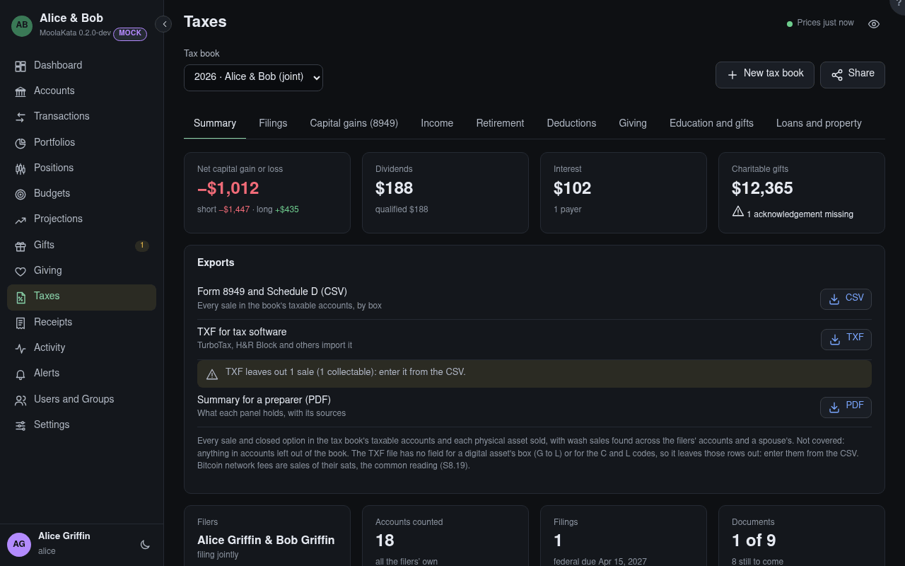

# Taxes: Summary

What a tax book holds: its filers, the accounts it counts, its filings and documents, and the
figures carried from last year.

## Tax book

The book shown: one tax year, for you alone or for you and your spouse filing jointly. **New tax
book** starts the next one; **Share** lets someone help, such as a preparer with an account here or
a grown child.

## Exports

Form 8949 and Schedule D as CSV, a TXF file that TurboTax, H&R Block and others import, and a PDF
summary for a preparer. Each says what it covers and what it doesn't. TXF has no place for a
digital asset's box (G to L) or for the codes C (a collectable) and L (a personal-use loss), so
those sales are left out of it, counted beside it, and entered from the CSV.

## Accounts counted

The filers' own accounts, each once even when they share them with each other. **Leave out** one
that doesn't belong; the panels say what was left out.

## Add an account

An account you can see but don't own that belongs in this return, such as a custodial account in a
child's name.

## From last year

What last year's filings carried forward: the AGI needed to sign this year's e-filed return,
capital-loss and charitable carryovers, and the Form 8606 basis. Each is from the book its filer
accepted last year, named with whose it was: after filing separately, a joint book shows both,
and the Summary adds their carryovers and last year's total tax.

## Your share of the joint carryover {#carryover-share}

Filing separately after a joint return: splitting its capital-loss carryover between you is yours
to decide, as your preparer reads it. None counts in the Summary until your share is typed, and an
issue asks for it.

## Short-term share {#share-short}

Your part of the joint return's short-term capital-loss carryover.

## Long-term share {#share-long}

Your part of the joint return's long-term capital-loss carryover.

## Dependents

The people the filers claim this year, each with how they're claimed, the months they lived with
you, whether a student, and their age on Dec 31. **Also claimed elsewhere** marks someone another
tax book claims for the same year. A dependent child's unearned income above the year's threshold is
flagged for Form 8615 (the kiddie tax). A new tax book copies them a year older, and says whom it
left out as past a qualifying child's age.

MoolaKata gathers what a preparer or tax software needs. It never computes the tax, chooses a filing
status, or files.
